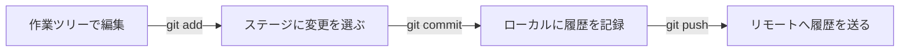

# Gitの使い方

Gitを初めて使う人のための日本語チュートリアルです。元の `git-tutorial` の題材をもとに、個人のアカウント・環境に依存しない説明と実習へ再構成しました。

## 読む順番

| ページ | 内容 |
| --- | --- |
| このページ | Gitの役割と全体像 |
| [準備とSSH](README2.md) | インストール、記録名義、SSH鍵 |
| [コマンドで使うGit](git/README.md) | ローカルで実習、ブランチ、リモートとの同期 |
| [Git付属のWeb UI：Gitweb](gitweb/README.md) | ブラウザーで履歴・差分・ファイルを閲覧する |
| [ローカルのベアリポジトリ](bare/README.md) | 共有先を作り、2つの作業場所でpush・pullする |
| [自前サーバーで共有する](server/README.md) | LinuxサーバーとSSH公開鍵で共有する |
| [GitHubのアカウント作成と初期設定](github/account.md) | 登録、メール非公開、2FA、Gitとの接続 |
| [GitHubを使う](github/README.md) | リポジトリ作成、共同作業、Pages |
| [GitHub Desktopで使うGit](github-desktop/README.md) | Windows・macOSのGUIでclone・コミット・ブランチ・送受信 |
| [GitLab.comの登録と初期設定](gitlab/account.md) | 公式ホスティングへの登録、メール・認証・接続 |
| [GitLabの自前サーバー構築](gitlab/self-managed.md) | Ubuntu、HTTPS、管理者・利用者、バックアップ |
| [GitLabを使う](gitlab/README.md) | Privateプロジェクト、clone、Merge Request |
| [VS Code標準のGit機能](vscode/README.md) | 差分・部分ステージ・コミット・グラフ・送受信 |
| [TortoiseGitで使うGit](tortoisegit/README.md) | Windowsの右クリックからclone・コミット・push／pull |
| [GUIで使うGit](old/README.md) | 画面操作で行うときの手順 |
| [用語集](dictionary.md) | よく出てくる言葉 |
| [例え話](tatoebanasi.md) | 変更の記録と共有のイメージ |

## Gitとは

Gitは、ファイルの変更を履歴として記録する分散型の[バージョン管理](dictionary.md#バージョン管理)システムです。プログラムだけでなく、メモや文章の管理にも使えます。

- どこを変更したか比較できる。
- いつ、どの名義で、どんな変更を記録したか確認できる。
- ブランチを分けて作業し、あとで変更を統合できる。
- 自分の端末だけで使い、あとから共有することもできる。

Gitの履歴はバックアップにも役立ちます。ただし、コミットしていない変更は履歴に残らず、同じ端末だけに保存している履歴は端末の故障に備えたバックアップにはなりません。

## Git・GitHub・GitLabの違い

| 名前 | 役割 |
| --- | --- |
| Git | 変更履歴を管理する仕組み・ソフトウェア |
| GitHub | Gitリポジトリの共有と共同作業を支援するホスティングサービス |
| GitLab | Gitリポジトリとレビューなどを提供するソフトウェア・サービス。公式ホスティングと自前運用を選べる |
| Gitクライアント | Gitを操作するためのコマンドやGUI。エディター内のGit操作画面も含む |

Gitを使うだけなら、GitHubのアカウントやインターネット接続は必要ありません。共有先にはGitHub以外のサービスや、自分で管理するサーバーも使えます。

## 変更を記録する流れ

`commit` は手元の履歴に記録する操作、`push` は共有先へ送る操作です。ファイルを編集しただけでは、どちらも行われません。

## まず覚えるコマンド

| コマンド | 何をするか |
| --- | --- |
| `git init` | 空のローカルリポジトリを作る |
| `git clone` | 既存のリポジトリを複製する |
| `git status` | 変更とステージの状態を確認する |
| `git diff` | ステージしていない追跡済みファイルの変更を見る |
| `git add` | 次のコミットに含める変更を選ぶ |
| `git commit` | ステージした内容を履歴に記録する |
| `git log` | コミット履歴を見る |
| `git fetch` | リモートの履歴を取得する。作業中のブランチには統合しない |
| `git pull` | リモートの履歴を取得し、現在のブランチへ統合する |
| `git push` | ローカルの履歴をリモートへ送る |

ブランチ・マージ・タグ・stash・変更の取り消しは、[コマンドの実習](git/README.md)で扱います。

## 最初に用意するファイル

- `README.md`：何のリポジトリか、どう使うかを書く。
- `LICENSE` などのライセンス文書：利用条件を示す。この教材では [LICENSE.md](LICENSE.md) を参照。
- `.gitignore`：Gitで管理しないファイルのパターンを書く。

`.gitignore` は、すでに追跡中のファイルや過去の履歴から情報を消す機能ではありません。公開前の確認は [公開用データの方針](PRIVACY.md) を参照してください。

## 公式資料

- [Gitのドキュメント](https://git-scm.com/docs)
- [Pro Git 日本語版](https://git-scm.com/book/ja/v2)
- [GitHub Docs 日本語版](https://docs.github.com/ja)
- [GitLab Docs](https://docs.gitlab.com/)

この教材の例に出てくる名前や `example.invalid` のアドレスは架空のものです。
