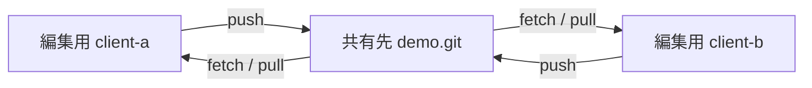

# ベアリポジトリをローカルで使う

[全体の案内へ戻る](../README.md) · [コマンドの実習](../git/README.md) · [自前サーバーで共有する](../server/README.md)

この章では、同じPCの中に「履歴を集める共有先」と「編集する場所」を分けて作ります。GitHubやSSHは使いません。コマンド例はGit 2.28以降と、Git Bash・macOS・Linuxのシェルを前提にしています。

## ベアリポジトリとは

ベアリポジトリは、通常の作業ツリーを持たず、履歴の保管やpushの受け取りに使うリポジトリです。

| 比較するもの | 通常のリポジトリ | ベアリポジトリ |
| --- | --- | --- |
| 主な用途 | ファイルを編集してコミットする | 共有する履歴を保管する |
| 作業用ファイル | ある | ない |
| Gitの管理データ | 通常は `.git/` の中 | リポジトリのディレクトリ自体にある |
| 作成方法 | `git init` | `git init --bare` |

名前を `demo.git` のようにするのは慣例です。末尾に `.git` を付けるだけではベアになりません。また、ベアにしても個人情報が消えたり、アクセス権が設定されたりするわけではありません。



## 1. 空の共有先を作る

`git-bare-lab` がまだ存在しない場所で始めます。以降の実習は、同じターミナルで順番に実行できます。

```sh
mkdir git-bare-lab
cd git-bare-lab
mkdir remotes workspaces
git init --bare -b main remotes/demo.git
git --git-dir=remotes/demo.git rev-parse --is-bare-repository
```

最後に `true` と表示されれば、ベアリポジトリです。`-b main` は、まだコミットがない段階の初期ブランチ名を指定しています。

作業場所は次のように分けます。

```text
git-bare-lab/
├── remotes/
│   └── demo.git/       共有先。ここで原稿を編集しない
└── workspaces/
    ├── client-a/      編集する場所A
    └── client-b/      編集する場所B
```

## 2. 編集する場所を作り、最初の履歴を送る

```sh
git clone remotes/demo.git workspaces/client-a
cd workspaces/client-a
git config --local user.name "Sample Contributor"
git config --local user.email "contributor@example.invalid"
git branch --show-current
printf '# 共有ノート\n' > notes.md
git add notes.md
git commit -m "Add shared notes"
git branch -M main
git push -u origin main
```

空の共有先をクローンするため、最初に「空のリポジトリ」という警告が出ることがあります。この段階では正常です。Gitのバージョンや通信方式によりクローン先の初期ブランチ名が異なる場合があるため、最初のコミット後に `git branch -M main` で名前をそろえています。

`origin` はこのPC内の `remotes/demo.git` を指しています。Gitでは、別のディレクトリもリモートとして使えます。`-u` により、手元の `main` の追跡先が `origin/main` になります。

共有先の履歴は、編集用ディレクトリから次のように確認できます。

```sh
git --git-dir=../../remotes/demo.git log --oneline --all
```

pushしても `remotes/demo.git/notes.md` は作られません。ファイルはGitのオブジェクトとして保存されています。内容を読みたい場合は次のように指定します。

```sh
git --git-dir=../../remotes/demo.git show main:notes.md
```

## 3. 別の作業場所から更新する

```sh
cd ../..
git clone remotes/demo.git workspaces/client-b
cd workspaces/client-b
git config --local user.name "Sample Contributor"
git config --local user.email "contributor@example.invalid"
printf '\n別の作業場所から追記した。\n' >> notes.md
git add notes.md
git commit -m "Update notes from second workspace"
git push origin main
```

2つのクローンは、それぞれ別の作業ツリーと履歴を持っています。片方でpushしても、もう片方のファイルが自動で書き換わることはありません。

## 4. 最初の作業場所へ取り込む

```sh
cd ../client-a
git fetch origin
git log --oneline --graph --all
git pull --ff-only origin main
git show HEAD:notes.md
```

`fetch` の時点では、まだ作業ファイルは更新されません。`pull --ff-only` が成功すると、`client-b` で追加した文章が取り込まれます。

実際に別のPCや人と共有するときも、基本は同じです。次の章では、ディレクトリのパスを [SSHの接続先](../server/README.md)に置き換えます。

## 既存のリポジトリに共有先を追加する

以下は上の練習とは別の例です。`/path/to/...` は自分の環境に置き換えてください。共有先は新しいディレクトリ、作業元はコミット済みの `main` がある通常のリポジトリとします。

```sh
git init --bare -b main /path/to/new-remote.git
cd /path/to/working-repository
git remote add local-share /path/to/new-remote.git
git push local-share main
```

`local-share` は未使用のリモート名を選びます。既存の `origin` や追跡先を維持するため、この例ではリモート名を追加し、pushに `-u` を付けていません。ほかのブランチやタグは、必要なものを別途pushします。

既存の履歴とローカルブランチ・タグから、最初からベアを作る方法もあります。

```sh
git clone --bare --no-hardlinks /path/to/working-repository /path/to/imported.git
```

これは別の作成方法です。既存の共有先へ重ねて実行しません。`--no-hardlinks` は、ローカルでオブジェクトの実体をコピーする指定です。履歴中の名前やメールアドレスも引き継ぐので、匿名化には使えません。リモート追跡ブランチだけにある履歴は、そのまま同名のローカルブランチになるわけではありません。

`clone --mirror` はリモート追跡参照なども含めて複製する用途で、通常の作業用クローンとは設定が異なります。この実習では使いません。

## バックアップと復元を試す

上の実習が終わり、`workspaces/client-a` にいる状態から実行します。`backups/demo.bundle` と `workspaces/restored` は、まだ存在しないものとします。

```sh
cd ../..
mkdir backups
git -C remotes/demo.git bundle create ../../backups/demo.bundle --all
git -C remotes/demo.git bundle verify ../../backups/demo.bundle
git clone backups/demo.bundle workspaces/restored
git -C workspaces/restored log --oneline --all
```

bundleは、この例では参照からたどれる履歴を1つのファイルにまとめます。未コミットの編集、リポジトリの設定、hooks、SSH鍵は入りません。復元したクローンの `origin` はbundleファイルなので、継続利用するときは共有先へ設定し直します。

運用では世代を分けて保存し、別のディスクや端末にも保管します。完全な運用環境の復元が必要なら、設定やhooksも別途管理します。コピーによるバックアップは、pushや保守処理を止めるか、一貫性を保てるスナップショット方式で行います。

## つまずきやすい点

| 状況 | 確認すること |
| --- | --- |
| ベアの中で `git status` や編集をしようとした | 作業ツリーが必要な操作は、通常のクローン側で行う |
| clone後に「remote HEADが存在しない」と言われる | 共有先の初期ブランチ名と、実際にpushしたブランチ名をそろえる |
| pushがnon-fast-forwardで拒否される | 他の変更をfetchし、履歴を確認してから統合する |
| 他のOSユーザーから書けない | OSの所有者・グループ・権限を確認する。安易に全員書き込み可能にしない |

共有先に `main` が存在するのにHEADだけが別名を指している場合は、共有先の管理者が次のように直せます。練習ルートからの例です。

```sh
git --git-dir=remotes/demo.git show-ref --verify refs/heads/main
git --git-dir=remotes/demo.git symbolic-ref HEAD refs/heads/main
```

これは既定の参照先を変える操作で、ブランチ自体の作成・改名ではありません。

この章の実習は、1つのOSユーザーが2つの作業場所を使う構成です。複数のOSユーザーで直接同じ保存領域へ書く構成では、グループとディレクトリの権限に加えて `git init --bare --shared=group` などの設定が必要です。`--shared` 自体はユーザー追加やネットワーク公開を行いません。少人数で別の端末から使う場合は、次の [SSHサーバー方式](../server/README.md)も選べます。

## 公式資料

- [git init：bareと初期ブランチ](https://git-scm.com/docs/git-init)
- [git clone：bare・mirror・ローカル複製](https://git-scm.com/docs/git-clone)
- [git bundle：履歴の持ち運びとバックアップ](https://git-scm.com/docs/git-bundle)
