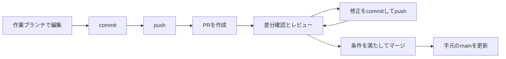

# GitHubのプルリクエストを使う

[全体の案内へ戻る](../README.md) · [GitHubの基本](README.md) · [アカウントの初期設定](account.md) · [GitHub Desktop](../github-desktop/README.md)

プルリクエスト（Pull Request、以下PR）は、あるブランチの変更を別のブランチへ取り込むための提案です。変更の目的、差分、レビュー、確認結果を1か所にまとめ、合意してからマージできます。文章や教材の修正にも使えます。

この章では、同じリポジトリの作業ブランチからPRを作る流れを基本に、fork、レビュー対応、競合解決、マージ後の整理まで説明します。コマンド例は読者が練習用リポジトリで使うためのもので、各操作の対象と実行結果を確認して進めます。

操作名はGitHubの英語表記を目印にし、日本語の意味を併記します。UI、権限、プラン、リポジトリのルールによって項目が異なる場合があります。公式資料の確認日：2026年11月7日。実アカウントでのPR作成・レビュー・マージ操作は未検証です。

## この章の案内

- [1. PRとGitの操作を区別する](#1-prとgitの操作を区別する)
- [2. base・headと権限を確認する](#2-baseheadと権限を確認する)
- [3. 作業ブランチを用意してpushする](#3-作業ブランチを用意してpushする)
- [4. ブラウザーでPRを作る](#4-ブラウザーでprを作る)
- [5. タイトル・本文・Issueとの関連付け](#5-タイトル本文issueとの関連付け)
- [6. Draftとレビュー依頼](#6-draftとレビュー依頼)
- [7. PR画面と差分の読み方](#7-pr画面と差分の読み方)
- [8. レビュアーがコメント・承認する](#8-レビュアーがコメント承認する)
- [9. 作成者が修正して再レビューを受ける](#9-作成者が修正して再レビューを受ける)
- [10. Checksとマージ条件を確認する](#10-checksとマージ条件を確認する)
- [11. baseの更新と競合を解決する](#11-baseの更新と競合を解決する)
- [12. forkから元のリポジトリへ提案する](#12-forkから元のリポジトリへ提案する)
- [13. 3種類のマージ方式を選ぶ](#13-3種類のマージ方式を選ぶ)
- [14. PRをマージする](#14-prをマージする)
- [15. マージ後の作業場所を整理する](#15-マージ後の作業場所を整理する)
- [16. Close・Reopen・Revertを区別する](#16-closereopenrevertを区別する)
- [17. Desktop・CLIから使う](#17-desktopcliから使う)
- [18. よくあるつまずき](#18-よくあるつまずき)
- [19. 最初の練習](#19-最初の練習)

## 1. PRとGitの操作を区別する

| 操作 | 何が起きるか |
| --- | --- |
| `git commit` | 手元のブランチに変更を記録する |
| `git push` | コミットをリモートのブランチへ送る |
| PRの作成 | GitHub上で、ブランチの変更を取り込む提案を開く |
| レビュー | 差分を読み、質問・修正提案・承認などを記録する |
| PRのマージ | 変更を取り込み先のブランチへ統合する |
| `git pull` | リモートの更新を手元へ取得して統合する |

PRを開くだけでは、取り込み先のファイルは更新されません。Approve（承認）も、マージする操作とは別です。PRという名前でも、`git pull` を実行して作るものではありません。



参考：[PRの役割と画面構成](https://docs.github.com/en/pull-requests/reference/pull-requests)

## 2. base・headと権限を確認する

PRの向きは、最初に確認するポイントです。

| 表示・用語 | 意味 | この章の基本例 |
| --- | --- | --- |
| base repository | 変更を取り込むリポジトリ | 同じリポジトリ |
| base branch | 変更を取り込むブランチ | `main` |
| head repository / head fork | 変更を送る側のリポジトリ | 同じリポジトリ、または自分のfork |
| head / compare branch | 提案する変更があるブランチ | `topic/add-notes` |

向きは **`topic/add-notes` の変更を `main` へ**です。`base: main ← compare: topic/add-notes` と読みます。画面の初期選択だけを信用せず、リポジトリ名も確認します。

同じリポジトリへ作業ブランチをpushするには、そのリポジトリへの書き込み権限が必要です。元のリポジトリへ書けない場合は、[forkからのPR](#12-forkから元のリポジトリへ提案する)を使います。非公開リポジトリでは、閲覧権限やforkを許可する設定にも従います。

PRを作れること、レビューを投稿できること、レビュアーを指定できること、マージできることは、それぞれ別の権限・条件です。参加先に `CONTRIBUTING.md` やPRテンプレートがあれば先に読みます。

参考：[PRの作成条件](https://docs.github.com/en/pull-requests/how-tos/create-pull-requests/creating-a-pull-request)、[レビューの権限](https://docs.github.com/en/pull-requests/reference/pull-request-reviews)

## 3. 作業ブランチを用意してpushする

次の例は、対象リポジトリをclone済みで、`origin` がその共有先、取り込み先が `main` の場合です。コミットの名義・認証は [初期設定](account.md)で準備しておきます。実際のブランチ名が違う場合は置き換えます。

### 起点を更新する

```sh
git status
git switch main
git pull --ff-only origin main
git switch -c topic/add-notes
```

最初の `git status` で未コミットの変更があれば、現在の作業を整理してから切り替えます。fast-forwardできない旨のエラーなら、手元と共有先の履歴が分岐しています。通信・認証エラーを含め、更新に失敗した場合は後続コマンドへ進まず、原因を確認します。`reset --hard` で消して進める手順ではありません。

### 変更を記録して送る

エディターで練習用の `notes.md` を作成・編集して保存したあと、次を実行します。

```sh
git status --short
git diff -- notes.md
git add -- notes.md
git diff --cached
git commit -m "Add notes about cloning"
git push -u origin topic/add-notes
```

新規ファイルは `git diff` だけでは表示されないため、エディターでも中身を読みます。コミット前の `git diff --cached` で、今回の変更だけが入っていることを確認します。

pushしてもPRは自動では作られません。ここまでで、GitHub上の作業ブランチへ提案内容を置いた状態です。

GitHub Desktopの場合は、作業ブランチで編集・コミットし、`Publish branch` または `Push origin` で送ります。詳しい操作は [Desktop編](../github-desktop/README.md#9-作業ブランチとpull-request)を参照してください。

## 4. ブラウザーでPRを作る

1. 取り込み先のGitHubリポジトリを開き、`Pull requests → New pull request`（新しいPR）を選びます。
2. `base` を `main`、`compare` を `topic/add-notes` にします。forkの場合はリポジトリの選択も必要です。
3. 表示されたコミットとファイルの差分を読み、無関係な変更がないか確認します。
4. 比較画面の `Create pull request` から入力画面へ進みます。
5. タイトルと本文を書き、準備できていれば `Create pull request` で作成します。途中なら次章のDraftを使います。
6. 作成後のPRで、番号・URL、base・head、差分をもう一度確認します。

最近pushした場合の `Compare & pull request` も作成画面への入口です。見当たらなくても、`Pull requests` から作成できます。

公開リポジトリでは、PR本文、コメント、コミット名義、添付なども他の人に見られます。送信する履歴や画像・ログは [公開用データの方針](../PRIVACY.md)に沿って確認します。

参考：[PR作成のQuickstart](https://docs.github.com/en/pull-requests/get-started/pull-request-quickstart)、[作成の詳細](https://docs.github.com/en/pull-requests/how-tos/create-pull-requests/creating-a-pull-request)

## 5. タイトル・本文・Issueとの関連付け

タイトルは、変更の結果が分かる短い文章にします。たとえば「修正」だけより、「clone後の作業フォルダー確認手順を追加」のほうが内容を判断しやすくなります。

本文では、レビュアーが「何の問題を、どう直し、何を確かめたか」を読めるようにします。次は自分で埋めるための例です。参加先のテンプレートがある場合はそちらを使います。

```markdown
## 目的
cloneしたあと、どのフォルダーを編集するか迷いやすいため、確認手順を追加します。

## 変更内容
- notes.md に作業フォルダーの確認方法を追加
- 関連する案内リンクを追加

## 確認方法と結果
- [ ] 変更した文章を読み直した
- [ ] 追加したローカルリンクの移動先を確認した
- 実行した確認と結果：ここに記入

## 影響・未確認事項
- 影響する利用者や操作：ここに記入
- 未確認の環境と理由：ここに記入

## 関連Issue
Refs #123
```

チェックは実際に確認したものだけに付けます。テストしていない場合は「未実施」と理由を書きます。目的や最終的な変更範囲が変わったら、本文も現在の内容へ更新します。

### Issueを閉じる指定

`Refs #123` は参照を示す例です。対応が完了してIssueを自動で閉じたい場合は、本文に `Closes #123` や `Fixes #123` を使えます。別のリポジトリなら `Closes OWNER/REPOSITORY#123` のように指定します。

PR本文の自動クローズ用キーワードは、PRのbaseがリポジトリのデフォルトブランチの場合に解釈され、そこへマージされたときにIssueを閉じます。PRを作っただけ、または任意の開発ブランチへマージしただけで、常に閉じるわけではありません。

参考：[Issueとの関連付け](https://docs.github.com/en/issues/tracking-your-work-with-issues/using-issues/linking-a-pull-request-to-an-issue)

## 6. Draftとレビュー依頼

### 作業途中ならDraft

作成ボタンのドロップダウンから `Create draft pull request` を選びます。Draftは作業途中という状態で、マージできません。**非公開にする機能ではありません。** 閲覧範囲はリポジトリの公開範囲・権限に従います。

レビューを受けられる状態になったら `Ready for review` を選びます。さらに作業が必要になったら、権限に応じて `Convert to draft` で戻せます。CODEOWNERSが設定され、変更したファイルに該当する所有者がいる場合、自動レビュー依頼はDraftをReadyにした時点で行われます。

### 誰に見てもらうか

`Reviewers`（レビュアー）から、内容に詳しい人やチームへ依頼します。`Assignees`（担当者）は作業の担当を表す欄で、レビュー依頼とは別です。`Labels`、`Milestone`、`Projects` は、参加先で使っていれば設定します。

レビュアーの指定には原則として書き込み権限などが必要で、PR作者なら必ず操作できるわけではありません。使えない場合は参加先の案内に従います。レビュー依頼は相手へ通知されるため、対象を確認して送ります。

参考：[DraftとReadyの切り替え](https://docs.github.com/en/pull-requests/how-tos/create-pull-requests/changing-the-stage-of-a-pull-request)、[レビュー依頼](https://docs.github.com/en/pull-requests/how-tos/create-pull-requests/requesting-a-pull-request-review)、[権限の詳細](https://docs.github.com/en/pull-requests/reference/pull-request-reviews)

## 7. PR画面と差分の読み方

| 主な表示 | 確認すること |
| --- | --- |
| `Conversation` | 本文、会話、レビュー、更新の経過、マージ条件 |
| `Commits` | PRに含まれるコミットと、その名義・変更内容 |
| `Checks` | 自動テストやビルドなどの結果とログ。設定によって表示内容が変わる |
| `Files changed` | PRで提案しているファイルの差分 |
| `Findings` など | 有効な機能に応じた自動レビュー・解析結果 |

作成者も、依頼前に `Files changed` を1ファイルずつ読みます。ファイル数、追加・削除、想定外の設定変更、改行だけの大量変更などを確認します。差分の外の文脈も必要なら開きます。

`Unified` は1列の差分、`Split` は左右の比較です。空白差分を隠す機能もありますが、空白に意味があるコードや設定では、非表示のまま判断しないようにします。大きい差分や一部のファイルは省略表示されることもあります。

### PRの差分は「共通祖先からheadまで」

GitHubのPRは原則として3点比較（three-dot diff）です。たとえば次の履歴なら、共通祖先は `B` です。

```text
A---B---C  main（base）
     \
      D---E  topic/add-notes（head）
```

| 比較 | この例で見る範囲 |
| --- | --- |
| PRの3点比較 | `B` から `E` まで。作業ブランチが導入した変更 |
| 両ブランチ先端の2点比較 | `C` と `E` の違い |

取得済みの参照で手元から確認する例です。

```sh
git diff origin/main...topic/add-notes
git diff origin/main..topic/add-notes
```

このため、PR差分を「最新mainへマージした後の全ファイルそのもの」とは考えません。baseの更新、競合、テスト結果も合わせて確認します。Compare画面と既存PRでは比較に使われる共通祖先が異なり、表示が違う場合もあります。

参考：[ブランチの比較と3点・2点diff](https://docs.github.com/en/pull-requests/reference/branches)、[PRとCompare画面の違い](https://docs.github.com/en/pull-requests/reference/pull-requests#differences-between-commits-on-compare-and-pull-request-pages)

## 8. レビュアーがコメント・承認する

まず本文で目的と確認結果を読み、その目的に照らして差分を確認します。「この変更で目的を満たすか」「既存の使い方を壊さないか」「確かめるべきケースが残っていないか」を見ます。

### 全体へのコメントと行へのコメント

- 全体の相談は `Conversation` へ書きます。
- 特定の行への指摘は `Files changed` の行番号横の `+` から書きます。複数行も選べます。
- 1件だけ送る場合は、表示されている `Comment` などの単独送信を使います。
- 複数の指摘をまとめる場合は `Start a review` で開始し、続きは `Add review comment` で追加します。

`Start a review` で保留したコメントは、レビューを提出するまで自分にしか見えません。書いたのに相手へ届かないときは、送信待ちになっていないか確認します。

`Viewed` は、自分がファイルを確認したという進捗の印です。Approveではなく、相手の変更をマージする操作でもありません。

### レビューを提出する

`Files changed` の `Review changes` または `Submit review` という入口から、まとめと判定を選んで `Submit review` で送信します。

| 判定 | 意味 |
| --- | --- |
| `Comment` | 質問や意見を伝える。承認・変更要求を明示しない |
| `Approve` | この変更を取り込んでよいと承認する |
| `Request changes` | マージ前に対応してほしい点を示す |

Approveはマージ操作とは別です。Auto-mergeが設定済みなら、承認によって条件がそろった時点で自動マージされる場合があります。自分が作成したPRを自分でApproveすることはできません。Approveが必須の承認数へ数えられるかも、レビュアーの権限やルールによります。`Request changes` がマージを止める条件になるかは、投稿者の権限とブランチ保護・rulesetの設定によります。

指摘には、場所だけでなく理由と期待する結果を書きます。たとえば「ここを修正」より「この相対パスだとリンク先が見つかりません。READMEから辿れるパスへ直してください」と書くと対応しやすくなります。

参考：[行コメントと会話](https://docs.github.com/en/pull-requests/how-tos/review-pull-requests/commenting-on-a-pull-request)、[レビューの詳細手順](https://docs.github.com/en/pull-requests/how-tos/review-pull-requests/reviewing-proposed-changes-in-a-pull-request)、[レビューQuickstart](https://docs.github.com/en/pull-requests/get-started/reviewing-pull-requests-quickstart)、[必須レビューと承認](https://docs.github.com/en/pull-requests/how-tos/review-pull-requests/approving-a-pull-request-with-required-reviews)

## 9. 作成者が修正して再レビューを受ける

### 同じブランチへ追加コミットする

コメントの意図を確認し、必要な変更を **PRのheadブランチ**で行います。まず未コミットの編集を整理してから切り替え、共有済みの更新を取り込みます。途中のコマンドに失敗した場合は原因を確認してから進めます。

```sh
git status
git switch topic/add-notes
git pull --ff-only origin topic/add-notes
```

作業ブランチが手元と共有先で一致していることを確認してから編集し、修正を記録します。

```sh
git add -- notes.md
git diff --cached
git commit -m "Clarify the clone notes after review"
git push origin topic/add-notes
```

同じheadへpushすると、開いているPRの差分とコミット一覧が更新されます。通常は、修正のたびに別のPRを作る必要はありません。初めは履歴を書き換えず、追加コミットで対応すると経過を追いやすくなります。

「指摘のリンクを修正しました。`notes.md` を再確認してください」のように返信し、必要なら `Reviewers` の再依頼ボタンで見直しを依頼します。設定によっては、新しいコミットで以前の承認が失効するので、最新のレビュー状態とChecksも確認します。

### Suggestionを適用する場合

レビュアーが具体的な修正案をSuggestionとして送った場合、内容を読んで `Commit suggestion` で適用できます。複数なら `Add suggestion to batch → Commit suggestions` でまとめられます。

これはGitHub上のheadブランチに実際の新しいコミットを作る操作です。適用後に手元で作業する場合は、その更新を取得します。未コミットの編集がなく、更新をfast-forwardで取り込める場合の例です。

```sh
git switch topic/add-notes
git pull --ff-only origin topic/add-notes
```

手元にも別のコミットがあって失敗した場合は、force pushで上書きせず、両側の変更を確認して統合方法を決めます。

`Resolve conversation` は、会話を解決済みとして整理する操作です。コードの修正、Approve、必須レビュー条件の充足を自動で行うものではありません。どの指摘をどう解決したか分かる返信を残します。

参考：[フィードバックへの対応](https://docs.github.com/en/pull-requests/concepts/resolving-reviews)、[Suggestionの適用と再レビュー](https://docs.github.com/en/pull-requests/how-tos/review-pull-requests/incorporating-feedback-in-your-pull-request)、[会話の解決](https://docs.github.com/en/pull-requests/how-tos/review-pull-requests/commenting-on-a-pull-request#resolving-conversations)

## 10. Checksとマージ条件を確認する

Checksは、自動テスト、ビルド、静的解析などの結果です。人によるApproveとは別の条件です。テストが成功してもレビューが不足する場合があり、承認済みでもテスト失敗でマージできない場合があります。

| 状態 | 確認すること |
| --- | --- |
| 成功 | どのコミット・統合候補に対して、何を実行したか |
| 失敗・タイムアウト | 詳細ログ、失敗した処理、再現方法 |
| 実行中・待機中 | 実行の完了、承認待ち、実行環境の状態 |
| 必須Checksが報告されない | workflowの条件・名前・起動条件が必須設定と合っているか |

古いコミットに付いた成功表示だけで、現在のPRも確認済みとは判断しません。headやGitHubのテスト用マージコミットなど、今回マージ対象となる内容に対する結果を確認します。

マージ欄には、必須レビュー、CODEOWNERSの承認、未解決の会話、必須Checks、baseとの更新状態などの不足条件が表示されます。参加先のルールに沿って解消します。マージボタンを有効にする目的で、保護設定を外す進め方にはしません。

参考：[Status checks](https://docs.github.com/en/pull-requests/reference/status-checks)、[必須Checksの問題を調べる](https://docs.github.com/en/pull-requests/how-tos/merge-and-close-pull-requests/troubleshooting-required-status-checks)、[保護ブランチ](https://docs.github.com/en/repositories/configuring-branches-and-merges-in-your-repository/managing-protected-branches/about-protected-branches)

## 11. baseの更新と競合を解決する

PRを開いている間にも、baseへ別の変更が入ります。古いbaseからの提案が必ずマージ不可になるわけではありませんが、更新が必須だったり、競合したりする場合があります。

### Update branchで更新する

PRに `Update branch` が表示される場合は、baseの更新をheadへ取り込めます。選択肢にマージとrebaseがある場合は、参加先の方式と履歴への影響を確認します。これはheadを更新する操作で、PRをbaseへマージする操作ではありません。

### Webで競合を直す

単純な行の競合は、PRの `Resolve conflicts` から解決できる場合があります。

1. 競合する両側の内容を読み、残す内容へ編集します。
2. `<<<<<<<`、`=======`、`>>>>>>>` の競合マーカーを取り除きます。
3. 各ファイルを `Mark as resolved` にします。
4. 全ファイルを確認して `Commit merge` を押します。

この操作では **baseブランチ全体がheadへマージ**されます。競合した行だけを書き換える操作ではありません。結果を確認してから、PR本体のマージへ進みます。headが保護ブランチなどの場合は、新しいheadの作成を求められることもあります。

### ローカルで競合を直す

Webで解決できない場合は、PRのheadを手元で更新します。次は同一リポジトリ、baseが `main`、headが `topic/add-notes` という例です。未コミットの編集がなく、headの共有済み更新も取り込める状態で進めます。

```sh
git switch topic/add-notes
git status
git pull --ff-only origin topic/add-notes
git fetch origin
git merge origin/main
```

途中のpull・fetchに失敗した場合は、次のmergeへ進まず原因を確認します。`git merge` が競合せず完了した場合は、追加の解決コミットは不要です。競合で停止した場合は、`git status` で対象を調べ、エディターで内容を解決して保存します。たとえば `notes.md` だけが競合した場合は次のように記録します。

```sh
git add -- notes.md
git diff --cached
git status
git commit -m "Merge main and resolve conflicts"
```

複数ファイルの競合なら、それぞれを解決して対象をaddします。削除と編集の競合では、残すのか削除するのかを決めます。未解決がないことと動作・文章の整合性を確認したあと、headへ送ります。

```sh
git push origin topic/add-notes
```

forkで元リポジトリを `upstream` と登録した場合は、baseの取得・取り込みを `git fetch upstream`、`git merge upstream/main` に読み替えます。送り先は自分のforkの `origin` です。

マージの途中で取りやめる場合は `git merge --abort` を使います。必要な解決作業は先に別途保存します。rebase中のAbortとは異なるので、`git status` で実行中の処理を確認します。

参考：[PRのheadをbaseに追従させる](https://docs.github.com/en/pull-requests/how-tos/create-pull-requests/keeping-your-pull-request-in-sync-with-the-base-branch)、[Webでの競合解決](https://docs.github.com/en/pull-requests/how-tos/merge-and-close-pull-requests/resolving-a-merge-conflict-on-github)、[CLIでの競合解決](https://docs.github.com/en/pull-requests/how-tos/merge-and-close-pull-requests/resolving-a-merge-conflict-using-the-command-line)

## 12. forkから元のリポジトリへ提案する

元のリポジトリへ直接pushできない場合は、自分のアカウント側にforkを作り、そのブランチからPRを送ります。forkはGitHub上の複製、cloneは手元への複製です。

1. 参加先の案内を読み、元リポジトリの `Fork` から自分のforkを作ります。
2. 自分のforkをcloneし、必要なコミット名義を確認します。
3. 最新の取り込み先を起点に作業ブランチを作り、編集・コミットします。
4. 自分のforkへ作業ブランチをpushします。
5. 元リポジトリのPR作成画面で `compare across forks` を選びます。
6. 次の4項目を確認し、差分・本文を確認してPRを作ります。

| 項目 | 選ぶもの |
| --- | --- |
| base repository | 提案先の元リポジトリ |
| base branch | 元リポジトリの取り込み先。例：`main` |
| head fork | 自分のfork |
| compare branch | forkへ送った作業ブランチ。例：`topic/add-notes` |

### originとupstreamを分ける

自分のforkをcloneした通常の構成では、`origin` は自分のforkを指します。元リポジトリの更新も取得する場合は、未使用の名前 `upstream` として追加できます。次はその構成を作る例です。

```sh
git clone https://github.com/YOUR-ACCOUNT/REPOSITORY.git
cd REPOSITORY
git remote -v
git remote add upstream https://github.com/UPSTREAM-OWNER/REPOSITORY.git
git fetch upstream
git switch -c topic/add-notes upstream/main
```

`YOUR-ACCOUNT`、`UPSTREAM-OWNER`、`REPOSITORY` は実際の値に置き換えます。すでに `upstream` がある場合は追加せず、設定済みの接続先を確認します。clone後の名義確認も、最初のコミット前に済ませてください。

編集してcommitしたら、送り先を自分のforkへ明示します。

```sh
git push -u origin topic/add-notes
```

この例では作成時に `upstream/main` を起点にしていますが、push後は作業ブランチが自分のforkの同名ブランチを追跡します。元のリポジトリへpushする権限は必要ありません。

### メンテナーによる編集を許可するか

`Allow edits from maintainers` は、元リポジトリへpushできる人が、fork側のPRブランチを編集できるようにする設定です。コメントやレビューを受けるためだけのチェックではありません。

forkにGitHub Actionsのworkflowがある場合は `Allow edits and access to secrets by maintainers` と表示されることがあり、workflowの編集を通じてsecret値が露出したり、他ブランチへのアクセスにつながったりする可能性があります。許可する対象と必要性を理解したうえで選びます。

参考：[forkからPRを作る](https://docs.github.com/en/pull-requests/how-tos/create-pull-requests/creating-a-pull-request-from-a-fork)、[forkの同期](https://docs.github.com/en/pull-requests/how-tos/work-with-forks/syncing-a-fork)、[メンテナーの編集許可](https://docs.github.com/en/pull-requests/how-tos/work-with-forks/allowing-changes-to-a-pull-request-branch-created-from-a-fork)

## 13. 3種類のマージ方式を選ぶ

利用できる方式はリポジトリの設定・ルールによります。普段の運用方針に合わせて選びます。

| 方式 | baseに残る履歴 | 選ぶ目安 |
| --- | --- | --- |
| `Create a merge commit` | 作業ブランチの各コミットを保持し、統合点のマージコミットを追加 | 個々のコミットや分岐の経緯も残したい |
| `Squash and merge` | PRの変更を新しい1コミットへまとめる | PRを1つの変更単位として残したい |
| `Rebase and merge` | 各コミットをbaseの先へ積み直す。マージコミットは作らない | 整理された個別コミットを直線的に並べたい |

Squashでは、中間の修正コミットがbaseに個別のコミットとして残るわけではありません。GitHubのRebase and mergeはコミッター情報を更新し、新しいコミットIDを作ります。Author（作成者）とCommitter（記録した人・処理）は区別してください。

元のコミットIDをそのままbaseの履歴へ残すことが必要なら、その要件も含めて方式を選びます。「どれもファイル内容が同じだから、履歴への影響も同じ」とは考えません。

Squash後に同じ作業ブランチを使い続けると、次のPRへ以前のコミットが再び出る場合があります。次の作業は、更新したbaseから新しい作業ブランチを作ると扱いやすくなります。

参考：[マージ方式と履歴への影響](https://docs.github.com/en/pull-requests/reference/pull-request-merges)

## 14. PRをマージする

マージ権限のある人が、最新の提案内容を確認して行います。作成者がマージする運用と、メンテナーがマージする運用があります。

1. base・head、最後の修正、レビューへの対応、最新のChecksを確認します。
2. Draftではないことと、マージ欄の必須条件が満たされていることを確認します。
3. 使用する方式を選びます。通常のマージなら `Merge pull request`、ほかはドロップダウンから選びます。
4. 表示されるコミットメッセージや、選択できる場合のメールアドレスも確認します。
5. `Confirm merge`、`Confirm squash and merge`、`Confirm rebase and merge` など、選んだ方式の確定ボタンを押します。
6. PRが `Merged` になり、baseへ意図した変更が入ったことを確認します。

ここで更新されるのはGitHub上のbaseです。手元の `main` が自動で同じ状態になるとは限らないので、次章で更新します。

### Auto-mergeとmerge queue

利用できるリポジトリでは、Auto-mergeで必要な承認・Checksを満たしたあとに自動でマージする予約を設定できます。設定した時点でマージ完了ではありません。

merge queueを要求するリポジトリでは、キューへ追加し、先行する変更との組み合わせも確認してから統合します。通常のマージボタンと選択肢が異なるため、表示されるルールに従います。どちらも権限・プラン・設定によって利用可否が変わります。

参考：[マージの手順](https://docs.github.com/en/pull-requests/how-tos/merge-and-close-pull-requests/merging-a-pull-request)、[Auto-merge](https://docs.github.com/en/pull-requests/how-tos/merge-and-close-pull-requests/automatically-merging-a-pull-request)、[merge queue](https://docs.github.com/en/pull-requests/how-tos/merge-and-close-pull-requests/merging-a-pull-request-with-a-merge-queue)

## 15. マージ後の作業場所を整理する

### リモートの作業ブランチ

不要になったheadは、PRの `Delete branch` から削除できます。自動削除される設定もあります。ほかの作業やopen PRで使われていないことを確認してから削除します。ブランチの削除と、PRや取り込まれたコミットの削除は別です。

### 手元のmain

同一リポジトリの例では、未コミットの編集を整理してから更新します。

```sh
git switch main
git pull --ff-only origin main
git log --oneline -5
```

fork構成で、手元の `main` を元リポジトリへ追従させる場合は、代わりに `git fetch upstream`、`git merge --ff-only upstream/main` を使えます。自分のfork側の `main` も更新したい場合は、その後に別途同期します。自動では両方更新されません。

### 手元の作業ブランチ

変更がbaseへ入ったことと、ブランチに残したい作業がないことを確かめてから削除します。

```sh
git branch -d topic/add-notes
```

SquashやRebase and mergeではコミットIDが異なるため、変更が入っていても `-d` が未マージとして削除を拒否することがあります。その場合は残したまま内容を確認します。すぐに `-D` で強制削除する必要はありません。

`-d` は、追跡先が設定されていればその追跡先、未設定なら現在のHEADへの取り込み状態を判定します。削除に成功したことだけでは、PRのbaseへ変更が入った証拠にはなりません。

次の作業は、更新した `main` から別の名前のブランチを作ります。

参考：[PRのブランチ削除・復元](https://docs.github.com/en/repositories/configuring-branches-and-merges-in-your-repository/managing-branches-in-your-repository/deleting-and-restoring-branches-in-a-pull-request)、[forkの同期](https://docs.github.com/en/pull-requests/how-tos/work-with-forks/syncing-a-fork)、[Squash後のブランチ](https://docs.github.com/en/pull-requests/reference/pull-request-merges#squashing-and-merging-a-long-running-branch)、[git branchの削除条件](https://git-scm.com/docs/git-branch)

## 16. Close・Reopen・Revertを区別する

| 操作 | 結果 |
| --- | --- |
| `Close pull request` | 提案をマージせず閉じる。baseへは取り込まない |
| `Reopen pull request` | 条件を満たす、マージせず閉じたPRを再開する |
| `Delete branch` | 対象のブランチを削除する。Closeとは別 |
| `Restore branch` | 利用できる場合に、削除したheadを復元する。PR再開とは別 |
| マージ済みPRの `Revert` | マージの変更を打ち消すための新しいPRを作る |

提案を取りやめる場合は、理由をコメントしてからCloseすると経緯が残ります。再開ボタンは権限やheadの状態によって使えない場合があります。MergedになったPRを再開して元に戻す方法ではありません。

マージ済みPRのRevertには、そのリポジトリへの書き込み権限が必要です。打ち消し用の変更を提案する操作なので、新しいPRの内容を確認してマージするまでは、元の変更は取り消されません。競合や、元のPRをGitHub以外でマージした場合などは、自動のRevertが使えず、別途打ち消しコミットが必要になる場合もあります。

参考：[PRを閉じる](https://docs.github.com/en/pull-requests/how-tos/merge-and-close-pull-requests/closing-a-pull-request)、[再開するCLIコマンド](https://cli.github.com/manual/gh_pr_reopen)、[マージ済みPRのRevert](https://docs.github.com/en/pull-requests/how-tos/merge-and-close-pull-requests/reverting-a-pull-request)

## 17. Desktop・CLIから使う

GitHub Desktopでは、headをpushしてから `Preview Pull Request` でbaseと差分を確認し、`Create Pull Request` からブラウザーで本文を入力して作成します。その後のレビューや最終的なマージは、まずGitHubのPR画面で進めると状態を追いやすくなります。

GitHub CLIの `gh` はGit本体とは別のツールで、インストールと認証が必要です。使える環境で、同一リポジトリのheadをpush済みなら、次のようにDraftを作ることもできます。

```sh
gh pr create --base main --head topic/add-notes --draft --title "clone後の確認手順を追加" --body-file PR_BODY.md
```

`PR_BODY.md` は自分で用意した本文ファイルです。秘密情報を含めず、Gitへ追加するかどうかも別に判断します。このコマンドは実際にGitHubへPRを作成します。確認だけなら、目的に応じて `gh pr view 42 --web` や `gh pr diff 42` を使います。`42` は対象のPR番号へ置き換えます。

VS Code標準のGit機能でcommit・pushし、ブラウザーからPRを作ることもできます。VS Code内でPRの作成・レビューを完結させる拡張機能は、[標準Git編](../vscode/README.md)で扱う範囲とは別です。

参考：[DesktopからPRを作る](https://docs.github.com/en/desktop/working-with-your-remote-repository-on-github-or-github-enterprise/creating-an-issue-or-pull-request-from-github-desktop)、[gh pr create](https://cli.github.com/manual/gh_pr_create)、[gh pr view](https://cli.github.com/manual/gh_pr_view)、[gh pr diff](https://cli.github.com/manual/gh_pr_diff)

## 18. よくあるつまずき

| 状況 | 確認・対応 |
| --- | --- |
| `There isn't anything to compare` など、差分が出ない | commit・push済みか、正しいbase・headか、すでに変更が取り込まれていないか |
| 関係のない変更や昔のコミットが大量に出る | 起点、base、fork、作業ブランチの使い回しを確認。先にPR差分と履歴を読む |
| baseを間違えた | openのPRなら編集からbaseを変更できる。比較範囲やコメントの位置付けが変わるため、変更後にCommits・Files changedを再確認する |
| 修正をpushしたのにPRへ出ない | 別のリポジトリ・ブランチへ送っていないか、PRのheadと一致するか |
| コメントが相手に見えない | Pending reviewのままになっていないか。まとめてSubmit reviewする |
| Reviewersを選べない | 指定権限があるか。PR作者というだけで必ず使える欄ではない |
| Approve済みなのにマージできない | 必須Checks、ほかの承認、CODEOWNERS、Draft、未解決会話、競合、更新条件を確認 |
| 前にChecksが通ったのに止まる | 最新のコミット・統合候補にも必要な結果があるか。追加修正で再実行・再承認が必要な場合がある |
| Checksが起動しない、Pendingが続く | 起動条件や必須Checks名を確認。workflow全体のスキップがPendingを残す場合もある |
| forkの実行が `Awaiting approval` | メンテナーによるworkflow実行承認待ちの場合がある。参加先の担当者へ確認 |
| `Resolve conflicts` が使えない | Webで対応できない競合か、編集権限の問題か。ローカル解決の手順へ進む |
| `Update branch` がない | 更新の必要性、競合、headの書き込み権限や保護状態を確認 |
| マージボタンが使えない | まずマージ欄の不足条件を読む。権限やリポジトリのルールも確認 |
| unrelated historiesと言われる | 履歴がつながるcloneか確認。`.git` の削除、初期化し直し、強制pushで押し通さない |

baseを変更すると、PR上の一部コミット表示や既存の行コメントの扱いが変わる場合があります。Gitの元コミットを消す操作ではありません。迷ったときはPR番号、base・head、直前に行った操作を整理して相談します。共有する画面やログには個人情報・認証情報を残さないようにします。

参考：[baseブランチの変更](https://docs.github.com/en/pull-requests/how-tos/create-pull-requests/changing-the-base-branch-of-a-pull-request)、[必須Checksの問題](https://docs.github.com/en/pull-requests/how-tos/merge-and-close-pull-requests/troubleshooting-required-status-checks)、[fork由来workflowの実行承認](https://docs.github.com/en/actions/how-tos/manage-workflow-runs/approve-runs-from-forks)

## 19. 最初の練習

自分が管理する、READMEのある練習用リポジトリで進めます。1人でも、差分と確認結果をPRへまとめる練習ができます。

1. 最新の `main` から `topic/add-notes` を作ります。
2. 文章を1か所だけ直し、commitして作業ブランチをpushします。
3. `base: main ← head: topic/add-notes` のDraft PRを作ります。
4. 自分でFiles changedを読み、本文に確認方法と結果を書きます。
5. 必要なら修正をcommitして同じheadへpushし、同じPRが更新されることを確認します。
6. Ready for reviewにします。共同練習なら相手にレビューしてもらいます。
7. 必要な条件を満たしたら、選んだ方式でマージします。1人の場合も自己Approveはできないため、必須レビューを設定したリポジトリでは別の適切なレビュアーが必要です。
8. 手元の `main` を更新し、変更が入ったことを確認します。

最初は小さい文章の変更にすると、差分、追加修正、履歴、マージ方式の違いを順に確認しやすくなります。
