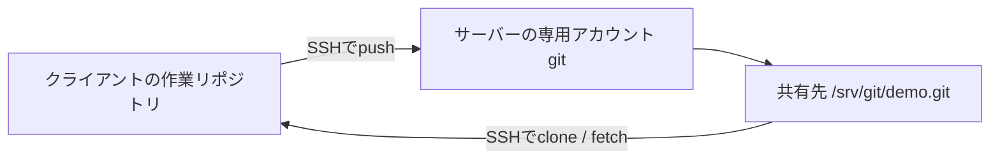

# 自前サーバーでGitを共有する

[全体の案内へ戻る](../README.md) · [ローカルのベア実習](../bare/README.md) · [準備とSSH](../README2.md)

この章では、Debian・Ubuntu系のLinuxサーバーにベアリポジトリを置き、クライアントからSSHでclone・pushする構成を作ります。GitHubのようなWeb画面やIssue機能は、この構成には含まれません。

Web画面や利用者ごとのプロジェクト権限も自前で運用する場合は、[GitLabのサーバー構築](../gitlab/self-managed.md)を参照してください。そちらは新規の別ホストを使う手順です。

## 構成と前提



| 項目 | この教材の例 |
| --- | --- |
| サーバーOS | Debian・Ubuntu系、systemdを使用 |
| Git | 2.28以降 |
| 管理者 | 通常の管理者アカウントから `sudo` を使用 |
| Git用アカウント | 新しく作る `git`。管理者用とは分ける |
| Git用ホーム | `/var/lib/git` |
| リポジトリ保存先 | `/srv/git/demo.git` |
| 接続先ホスト | `git-server.example.invalid`。実際のホスト名やIPに置き換える |
| 接続方法 | 到達できるLAN・VPNなどを経由するSSH公開鍵認証 |

以下の「サーバー管理者」と「クライアント」は、実行する端末が異なります。既存の `git` アカウントや保存先がある場合は、その用途・権限を確認し、上書きする手順として使わないでください。

この方式は、同じ権限でリポジトリを読み書きする少人数の利用を想定しています。登録した鍵は、いずれも `git` アカウントの権限を使います。リポジトリ別・利用者別の権限分離が必要なら、アクセス制御を備えたGitサーバー製品などを検討します。

## 1. サーバー管理者：GitとOpenSSHを用意する

```sh
sudo apt update
sudo apt install git openssh-server
git --version
command -v git-shell
sudo systemctl enable --now ssh
sudo systemctl status ssh --no-pager
```

この教材では `git-shell` の場所を `/usr/bin/git-shell` とします。表示された場所が異なる場合は、後の指定も合わせます。

クライアントからサーバーのSSHポートへ届く必要があります。ファイアウォール・VPN・ルーターの設定は、既存の管理接続を保ちながら、利用するネットワークに合わせます。インターネット全体への公開や、Git専用ポートの開放は必須ではありません。

この手順では、標準的なDebian・UbuntuのSSH設定を前提にしています。`AllowUsers`、`Match`、認証方式などを独自設定している場合は、`git` の公開鍵認証が許可されるかも確認します。

## 2. サーバー管理者：専用アカウントを作る

`git` アカウントがまだ存在しないことを確認してから実行します。

```sh
getent passwd git
```

既存のアカウントが表示された場合は、その用途を確認します。存在しない場合に、新しく作成します。

```sh
sudo adduser --system --group --home /var/lib/git --shell /usr/bin/git-shell git
sudo install -d -m 750 -o git -g git /srv/git
```

`git-shell` は、SSH接続から実行できるコマンドをGitの送受信などへ制限するシェルです。管理作業をするための通常のシェルは提供しません。この教材では、追加の `git-shell-commands` も作りません。

このアカウントにはパスワードを設定せず、後で公開鍵を登録します。標準のDebian・UbuntuのPAM構成を前提とし、独自のアカウント制限がある環境では別途確認します。ログインできない場合に、空のパスワードを設定して対処しないでください。

`pam_shells` などでログインシェルを検査する環境では、管理者が `/etc/shells` に実際の `git-shell` のパスを登録する必要がある場合もあります。

## 3. クライアント：公開鍵を用意する

[準備とSSH](../README2.md)で作った、専用のSSH鍵を使います。まだない場合は、同名の鍵が存在しないことを確認して作成してください。

```sh
mkdir -p ~/.ssh
ssh-keygen -t ed25519 -f ~/.ssh/git_tutorial_ed25519 -C "git-tutorial-example"
```

パスフレーズを設定します。サーバー管理者へ渡すのは、次の公開鍵ファイルの内容だけです。

```sh
cat ~/.ssh/git_tutorial_ed25519.pub
```

`.pub` が付かないファイルは秘密鍵です。クライアント側で保管し、サーバーやリポジトリへコピーしません。公開鍵の末尾のコメントにも端末名やメールが入ることがあるため、この例では汎用のコメントを使っています。

## 4. サーバー管理者：公開鍵を登録する

```sh
sudo install -d -m 700 -o git -g git /var/lib/git/.ssh
sudo -u git touch /var/lib/git/.ssh/authorized_keys
sudo chmod 600 /var/lib/git/.ssh/authorized_keys
sudoedit /var/lib/git/.ssh/authorized_keys
```

編集画面で、受け取った公開鍵の先頭に `restrict` と空白を付け、1行で追記します。次は形式を示すための例です。`REPLACE_WITH_PUBLIC_KEY_DATA` の文字列をそのまま登録せず、実際の公開鍵を使います。

```text
restrict ssh-ed25519 REPLACE_WITH_PUBLIC_KEY_DATA git-tutorial-example
```

利用者を増やす場合は、共有する1本の秘密鍵を配らず、利用者ごとに公開鍵を1行ずつ登録します。すべての登録鍵に `restrict` を付けます。不要になった鍵は、対応する行を削除して失効させます。

`restrict` は、ポート転送・エージェント転送・X11転送・PTYなどを制限します。`git-shell` だけでは転送まで無効にならないため、両方を使います。

なお、これらはリポジトリごとのアクセス制御ではありません。各鍵は、OSの権限上 `git` がアクセスできるリポジトリを利用できます。コミットの名義も利用者が設定するため、SSH鍵による接続とコミットの本人確認は別です。

## 5. サーバー管理者：ベアリポジトリを作る

`/srv/git/demo.git` がまだ存在しない場合に実行します。

```sh
sudo -u git git init --bare -b main /srv/git/demo.git
sudo -u git git --git-dir=/srv/git/demo.git rev-parse --is-bare-repository
sudo -u git git --git-dir=/srv/git/demo.git symbolic-ref HEAD
```

それぞれ `true`、`refs/heads/main` が表示されれば、想定した構成です。リポジトリの作成・設定も `git` の権限で行い、root所有のファイルを混在させないようにします。

必要に応じて、履歴が後戻りするpushを拒否する設定もできます。

```sh
sudo -u git git --git-dir=/srv/git/demo.git config receive.denyNonFastForwards true
```

この設定はforce指定のpushにも適用されます。ブランチ削除や利用者別権限をまとめて保護する設定ではありません。

## 6. 接続先のホスト鍵を確認する

サーバー管理者が、サーバーのホスト公開鍵のフィンガープリントを確認します。

```sh
sudo ssh-keygen -lf /etc/ssh/ssh_host_ed25519_key.pub
```

この鍵は、利用者の認証鍵とは別です。クライアントの初回接続で表示された鍵種とフィンガープリントを、管理者から信頼できる経路で受け取った情報と照合します。別の種類のホスト鍵が提示された場合は、管理者に対応する公開鍵を確認してもらいます。

## 7. クライアント：接続設定を登録する

クライアントの `~/.ssh/config` をエディターで開き、既存の設定を残して次を追加します。`HostName` は実際に到達できる接続先へ置き換えます。

```sshconfig
Host git-tutorial-server
    HostName git-server.example.invalid
    User git
    Port 22
    IdentityFile ~/.ssh/git_tutorial_ed25519
    IdentitiesOnly yes
```

macOS・Linuxでは、設定ファイルの権限も確認します。

```sh
chmod 600 ~/.ssh/config
```

空のリポジトリへ接続し、ホスト鍵を照合してから接続を許可します。

```sh
git ls-remote git-tutorial-server:/srv/git/demo.git
```

まだ履歴がなければ、参照は表示されません。エラーなく終了すれば、接続とリポジトリの読み取りは成功です。

`ssh git-tutorial-server` で通常のログインを試すと、対話シェルを許可しない旨が表示されることがあります。この構成では想定された動作です。Git接続は `git ls-remote` や `git clone` で確認します。

## 8. クライアント：最初のコミットを送る

手元の `demo` がまだ存在しない場所で実行します。

```sh
git clone git-tutorial-server:/srv/git/demo.git demo
cd demo
git config --local user.name "Sample Contributor"
git config --local user.email "contributor@example.invalid"
printf '# サーバー共有の練習\n' > README.md
git add README.md
git commit -m "Add server practice readme"
git branch -M main
git push -u origin main
git ls-remote --heads origin
```

最初のcloneでは、空のリポジトリという警告が出る場合があります。Gitのバージョンや通信方式による初期ブランチ名の違いを吸収するため、最初のコミット後に名前を `main` へそろえています。push後は `refs/heads/main` とコミットIDが表示されます。

別の端末でも同じように公開鍵と接続設定を用意すれば、次のように取得できます。

```sh
git clone git-tutorial-server:/srv/git/demo.git demo-second
```

その後のcommit・push・fetch・pullは、[ローカルのベア実習](../bare/README.md)と同じです。サーバー上のベアに作業用ファイルが展開されない点も同じです。

### 既存の作業リポジトリから送る場合

以下は別の例です。手元にコミット済みの `main` があり、サーバー側は空とします。`/path/to/...` は自分の環境に置き換えます。

```sh
cd /path/to/working-repository
git remote add self-hosted git-tutorial-server:/srv/git/demo.git
git push self-hosted main
```

`self-hosted` は未使用のリモート名を選びます。既存の `origin` や追跡先は維持します。両側に独立した初期コミットがある場合は、この手順をそのまま使わず、どちらの履歴を使うか整理してください。

### URLとポートの書き方

| 形式 | 例 |
| --- | --- |
| SSH設定の別名を使う | `git-tutorial-server:/srv/git/demo.git` |
| ユーザー・ホストを直接指定する | `git@git-server.example.invalid:/srv/git/demo.git` |
| ポートもURLで指定する | `ssh://git@git-server.example.invalid:2222/srv/git/demo.git` |

最後の例は、実際にSSHが2222番で待ち受けている場合だけ使います。`host:2222/path` という書き方では、2222はポート指定になりません。

## 運用とトラブル対応

| 症状・作業 | 確認すること |
| --- | --- |
| 接続がタイムアウトする | ホスト名、経路、VPN、待ち受けポート、ファイアウォール |
| `Permission denied (publickey)` | 登録した公開鍵、接続先ユーザー、使用する秘密鍵、`.ssh` とファイルの所有者・権限、SSH/PAMの許可設定 |
| repository not found・アクセス拒否 | サーバー側の絶対パス、リポジトリの存在、`git` の読み書き権限 |
| remote HEADが存在しない | サーバーのHEADが指す名前と、pushしたブランチ名が一致するか |
| non-fast-forwardでpushできない | fetchして双方の履歴を確認し、変更を統合する |
| バックアップ | ベアの履歴に加え、必要な設定・hooks・鍵登録・SSH設定を別途保管し、復元も確認する |

サーバー管理者は、次のようにSSH設定の構文とログを確認できます。

```sh
sudo /usr/sbin/sshd -t
sudo journalctl -u ssh -n 50 --no-pager
```

SSH設定を変更する場合は、現在の管理接続を残し、構文確認後に反映して、別の接続で利用できることを確認します。独自のPAM設定やアカウント期限で拒否される場合は、それらの設定と有効なSSH設定も確認します。

履歴だけの持ち運びは、[ローカル実習のbundleバックアップ](../bare/README.md#バックアップと復元を試す)を参照してください。ベアのディレクトリ全体をバックアップする場合は、pushや保守処理を止めるか、一貫性のあるスナップショットを使います。`git` の所有権と必要な権限も復元します。

サーバーの更新、保存容量、利用しなくなった鍵の削除も管理します。ログや接続設定を他の人へ共有する際は、[公開用データの方針](../PRIVACY.md)に沿って、個人情報や内部接続先を除いてください。

## 公式資料

- [Gitサーバーのセットアップ](https://git-scm.com/book/en/v2/Git-on-the-Server-Setting-Up-the-Server)
- [git-shell](https://git-scm.com/docs/git-shell)
- [Debian adduser](https://manpages.debian.org/trixie/adduser/adduser.8.en.html)
- [OpenSSH：authorized_keysとrestrict](https://man.openbsd.org/sshd.8)
- [Debianのsshd_config](https://manpages.debian.org/trixie/openssh-server/sshd_config.5.en.html)
- [UbuntuのOpenSSHサーバー案内](https://ubuntu.com/server/docs/how-to/security/openssh-server/)
